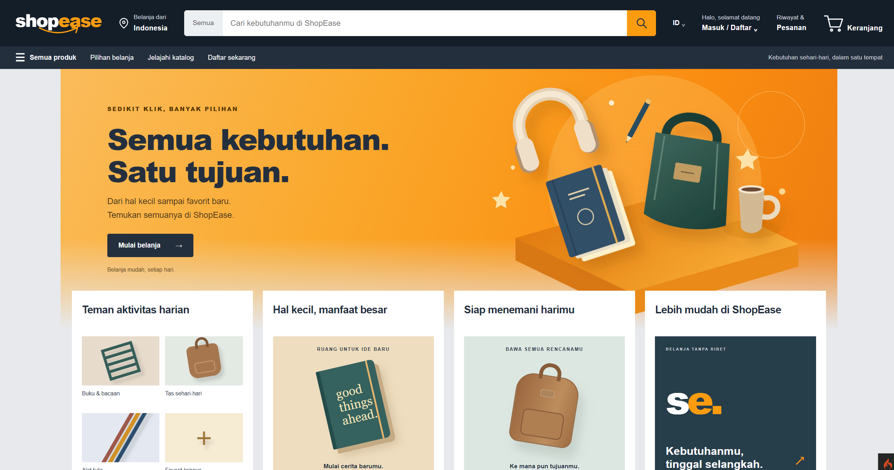

# PBKK Week 10 — ShopEase

| Identitas | Keterangan |
|---|---|
| Kelas | Pemrograman Berbasis Kerangka Kerja D |
| Materi | CodeIgniter 4 — Routing, Controller, dan View |
| Proyek | ShopEase |

## 1. Pendahuluan

ShopEase merupakan aplikasi toko online untuk pembelajaran Pemrograman Berbasis Kerangka Kerja menggunakan CodeIgniter 4. Aplikasi menerapkan routing, controller, model, dan view untuk menghubungkan katalog produk dengan alur belanja pengguna.

Pengunjung dapat menelusuri dan mencari produk, sedangkan customer dapat mengelola keranjang, melakukan checkout, serta mengunggah bukti pembayaran manual. Administrator mengelola katalog dan memverifikasi pembayaran. Operator memiliki akses baca terhadap pesanan.

Data aplikasi disimpan di MySQL atau MariaDB menggunakan InnoDB. Antarmuka menggunakan view PHP, Bootstrap 5, dan CSS khusus dengan tampilan marketplace berwarna oranye dan biru gelap.



## 2. Teknologi yang Digunakan

| Teknologi | Fungsi |
|---|---|
| PHP 8.2+ dan CodeIgniter 4.7 | Routing, controller, model, view, validasi, dan session |
| MySQL / MariaDB dengan InnoDB | Penyimpanan pengguna, katalog, keranjang, alamat, dan pesanan |
| Bootstrap 5 | Komponen antarmuka dan tata letak responsif |
| CSS khusus dan SVG lokal | Tema marketplace, hero, dan ilustrasi promosi |
| Composer | Pengelolaan dependensi PHP |
| PHPUnit | Pengujian aplikasi dan integrasi alur bisnis |

## 3. Struktur Proyek

```text
ShopEase/
├── app/
│   ├── Config/Routes.php          # Definisi route aplikasi
│   ├── Controllers/              # Controller katalog, autentikasi, dan transaksi
│   │   └── Admin/                # Pengelolaan katalog dan pesanan
│   ├── Database/                 # Migration dan seeder
│   ├── Filters/                  # Pembatasan akses berdasarkan autentikasi/role
│   ├── Models/                   # Akses data aplikasi
│   ├── Services/                 # Logika transaksi checkout dan status pesanan
│   └── Views/shop/               # Layout bersama dan halaman toko
├── public/
│   └── assets/                   # CSS dan ilustrasi lokal
├── tests/
│   └── integration/              # Pengujian alur bisnis
├── writable/                     # Session, log, cache, dan upload
├── .gitignore
├── composer.json
├── composer.lock
├── env                           # Contoh konfigurasi lingkungan
├── README.md
└── spark                         # CLI CodeIgniter
```

Backend berada di `app/`, sedangkan aset antarmuka berada di `public/assets/`. Gambar produk dan bukti pembayaran disimpan di `writable/uploads/`, di luar document root, lalu disajikan melalui controller sesuai aturan akses.

## 4. Implementasi Routing, Controller, dan View

### Routing

[Routes.php](app/Config/Routes.php) memetakan URL dan metode HTTP ke controller secara eksplisit:

```php
$routes->get('/', 'ProductController::index');
$routes->get('products', 'ProductController::index');
$routes->get('products/(:num)', 'ProductController::show/$1');
$routes->get('login', 'AuthController::login');
$routes->post('login', 'AuthController::authenticate');
$routes->get('register', 'AuthController::register');
$routes->post('register', 'AuthController::store');
```

Beranda dan `/products` menggunakan method katalog yang sama. Detail produk menggunakan ID numerik, misalnya `/products/1`. Produk yang tidak ditemukan atau tidak aktif mengembalikan HTTP 404.

Route keranjang, checkout, dan pesanan customer berada dalam grup dengan filter `shopAuth:customer`. Route admin menggunakan filter berdasarkan role; operator dapat membaca pesanan, sedangkan pengelolaan katalog dan perubahan status hanya tersedia bagi administrator.

### Controller

[ProductController.php](app/Controllers/ProductController.php) mengambil produk aktif melalui `ProductModel`, menerima pencarian dari parameter GET `q`, lalu meneruskan hasil ke view katalog. Berikut bagian pemanggilan view pada method `index()`:

```php
return $this->page('catalog', [
    'products' => $products->orderBy('id', 'DESC')->findAll(),
    'search' => $search,
]);
```

Method `page()` pada [ShopController.php](app/Controllers/ShopController.php) memanggil view dalam direktori `shop/` sekaligus menyertakan pengguna yang sedang login:

```php
protected function page(string $view, array $data = []): string
{
    return view('shop/' . $view, $data + ['user' => $this->user()]);
}
```

Controller lain menangani autentikasi, keranjang, checkout, dan pesanan. Logika transaksi checkout serta perubahan status ditempatkan di `app/Services/`, sedangkan akses tabel menggunakan model di `app/Models/`.

### View PHP

[View detail produk](app/Views/shop/product.php) memperluas layout bersama dan mengisi bagian `content`. Berikut cuplikan sederhana pola view tersebut:

```php
<?= $this->extend('shop/layout') ?>
<?= $this->section('content') ?>
<h1><?= esc($product['name']) ?></h1>
<p><?= nl2br(esc($product['description'])) ?></p>
<?= $this->endSection() ?>
```

[Layout bersama](app/Views/shop/layout.php) menyediakan header, navigasi berdasarkan role, pencarian, dan footer. Form menggunakan token CSRF, sedangkan data dinamis di-escape sebelum ditampilkan.

Alurnya adalah request → route CodeIgniter → controller → model atau service → view PHP → respons HTML. Halaman dirender di server dan dapat diakses langsung melalui URL masing-masing.

## 5. Implementasi Halaman ShopEase

| Halaman | Fungsi |
|---|---|
| Homepage (`/`) | Hero promosi, kartu penelusuran, pencarian, dan katalog produk aktif |
| Products (`/products`) | Katalog dengan pencarian nama dan deskripsi produk |
| Product Detail (`/products/{id}`) | Gambar, deskripsi, harga, stok, dan form tambah ke keranjang |
| Login dan Register (`/login`, `/register`) | Autentikasi dan pendaftaran akun customer |
| Keranjang (`/cart`) | Daftar produk, perubahan kuantitas, dan penghapusan item |
| Checkout (`/checkout`) | Pemilihan alamat dan konfirmasi pesanan |
| Pesanan (`/orders`, `/orders/{id}`) | Riwayat, detail pesanan, dan unggah bukti pembayaran |
| Katalog admin (`/admin/categories`, `/admin/products`) | Pengelolaan kategori, produk, stok, harga, status, dan gambar |
| Pesanan admin (`/admin/orders`) | Pembacaan pesanan serta verifikasi atau pembatalan oleh administrator |

Navbar menyediakan identitas ShopEase, pencarian, akses akun, pesanan, dan keranjang. Tata letak menyesuaikan ukuran layar menggunakan Bootstrap serta [shop.css](public/assets/shop.css).

## 6. Fitur Tambahan

- **Pencarian produk:** parameter `q` menelusuri nama dan deskripsi produk aktif. Produk ditampilkan berdasarkan ID terbaru.
- **Autentikasi tiga role:** administrator, operator, dan customer memiliki hak akses berbeda. Registrasi publik selalu membuat customer.
- **Katalog dan gambar:** administrator dapat mengelola kategori, produk, harga, stok, status, dan gambar. Slug harus unik serta menggunakan huruf kecil, angka, atau tanda hubung.
- **Checkout transaksional:** cart dan produk dikunci, harga dihitung menggunakan BCMath, snapshot item/alamat disimpan, stok dikurangi, dan cart dikosongkan dalam satu transaksi. Token checkout unik mencegah submit ganda.
- **Pembayaran manual:** customer mengunggah bukti JPEG/PNG maksimal 2 MB. Administrator dapat menerima atau menolak dengan alasan; penolakan memungkinkan unggah ulang.
- **Status pesanan:** alur utama `pending_payment` → `waiting_verification` → `processing`. Penolakan mengembalikan pesanan ke `pending_payment`, sedangkan pembatalan sebelum pembayaran diterima mengubahnya ke `cancelled` dan mengembalikan stok satu kali.
- **Riwayat transaksi:** snapshot menjaga informasi pesanan lama. Ongkir disalin dari konfigurasi saat checkout sehingga perubahan tarif tidak mengubah pesanan sebelumnya.
- **Akses upload:** customer hanya dapat membaca transaksi dan bukti miliknya. Produk dinonaktifkan, dan kategori yang masih memiliki produk tidak dapat dihapus.

Pengiriman, filter kategori, pagination, dashboard statistik, dan laporan belum diimplementasikan.

## 7. Instalasi dan Persiapan Lingkungan

### Persyaratan

Gunakan PHP 8.2 atau lebih baru dalam seri PHP 8, Composer, MySQL atau MariaDB dengan InnoDB, serta browser modern. Aktifkan ekstensi PHP `intl`, `mbstring`, `mysqli`, `fileinfo`, `bcmath`, `dom`, dan `xml`.

Bootstrap dimuat dari CDN sehingga tampilan memerlukan koneksi internet. Dependensi aplikasi dipasang melalui Composer.

### Dependensi aplikasi

Dari direktori `ShopEase/`, jalankan:

```sh
composer install
```

Salin file `env` menjadi `.env` jika belum tersedia, kemudian sesuaikan konfigurasi lokal berikut:

```ini
CI_ENVIRONMENT = development
app.baseURL = 'http://localhost:8080/'

database.default.hostname = localhost
database.default.database = db_shopease
database.default.username = YOUR_DATABASE_USER
database.default.password = YOUR_DATABASE_PASSWORD
database.default.DBDriver = MySQLi
database.default.port = 3306

shop.shippingCost = 10000.00
shop.bankInstructions = 'Bank Demo - rekening contoh 0000000000 a.n. ShopEase'
shop.seedPassword = 'CHANGE_TO_YOUR_LOCAL_PASSWORD'
```

Gunakan password seed lokal minimal delapan karakter. File `.env` berisi konfigurasi lokal dan tidak disertakan dalam Git.

### Database dan data awal

Jalankan MySQL atau MariaDB, lalu buat database kosong:

```sql
CREATE DATABASE db_shopease CHARACTER SET utf8mb4 COLLATE utf8mb4_unicode_ci;
```

Jalankan migration dan seeder dari direktori `ShopEase/`:

```sh
php spark migrate
php spark db:seed ShopSeeder
```

Seeder dapat dijalankan ulang tanpa menduplikasi data dan tidak mengubah password akun yang sudah ada. Akun demo yang tersedia:

| Role | Email |
|---|---|
| Administrator | `administrator@example.test` |
| Operator | `operator@example.test` |
| Customer | `customer@example.test` |

Password akun demo berasal dari nilai `shop.seedPassword` saat akun dibuat.

PHP harus dapat menulis ke `writable/` dan direktori `upload_tmp_dir` pada `php.ini`. Jika upload gagal pada XAMPP, arahkan `upload_tmp_dir` ke direktori sementara yang dapat ditulis sebelum menjalankan server. Atur `upload_max_filesize` minimal 2 MB dan `post_max_size` lebih besar dari 2 MB.

## 8. Cara Menjalankan Aplikasi

Dari direktori `ShopEase/`:

```sh
php spark serve --host 127.0.0.1 --port 8080
```

Buka [http://localhost:8080/](http://localhost:8080/).

### Alur penggunaan

1. Login sebagai administrator untuk menambahkan kategori, produk, stok, harga, dan gambar.
2. Daftar atau login sebagai customer, lalu pilih produk dan tambahkan ke keranjang.
3. Ubah kuantitas, lanjutkan checkout, lalu tambahkan atau pilih alamat.
4. Konfirmasikan pesanan, transfer sesuai instruksi demo, dan unggah bukti pembayaran.
5. Login sebagai administrator untuk melihat bukti serta menerima atau menolak pembayaran. Pembayaran yang diterima memindahkan pesanan ke `processing`.

### Pengujian

```sh
php vendor/bin/phpunit --no-coverage
php spark routes
```

Tes integrasi membutuhkan koneksi MySQL khusus dengan nama database berakhiran `_test`; tes menghapus dan membuat ulang tabel ShopEase. Contoh konfigurasi melalui PowerShell:

```powershell
${env:database.tests.hostname}='127.0.0.1'
${env:database.tests.port}='3306'
${env:database.tests.database}='shopease_test'
${env:database.tests.username}='YOUR_TEST_USER'
${env:database.tests.password}='YOUR_TEST_PASSWORD'
${env:database.tests.DBDriver}='MySQLi'
php vendor/bin/phpunit --no-coverage
```

Tes integrasi dilewati jika koneksi tes tidak memenuhi syarat tersebut. Pada sesi implementasi awal, 14 tes dan 57 assertion lulus pada MariaDB terisolasi. Setelah revisi UI, 14 tes dijalankan dengan 7 assertion dan 9 tes integrasi dilewati karena database pengujian belum diaktifkan; tidak ada kegagalan. Pemeriksaan visual browser desktop/mobile dan checkout yang benar-benar paralel belum dilakukan.
