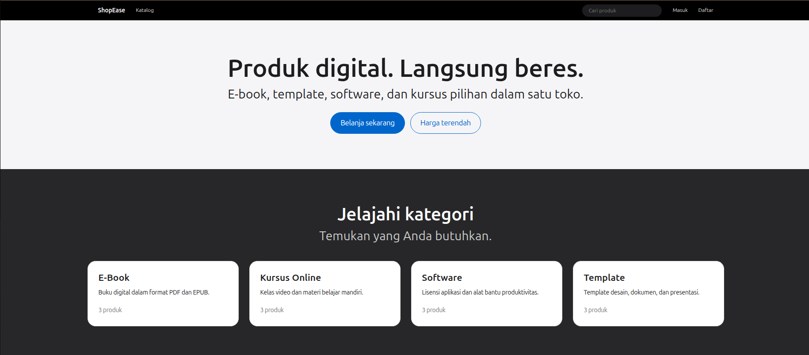
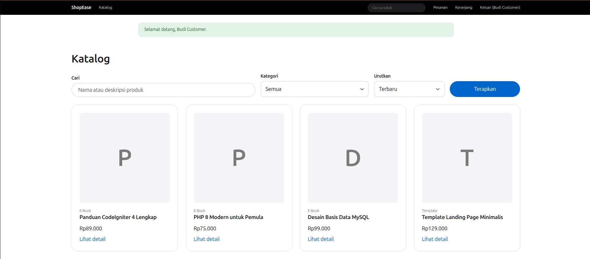
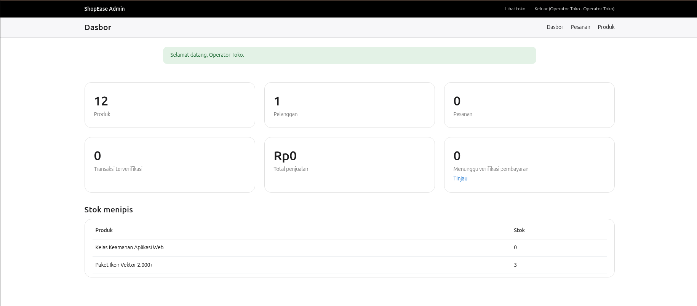
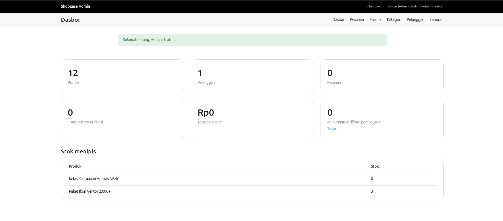
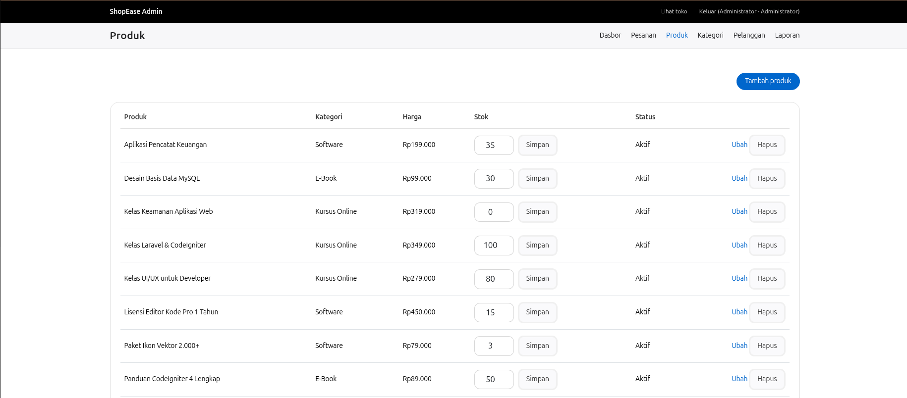

# ShopEase — Toko Online Produk Digital (PBKK Pertemuan 11)

Aplikasi toko online berbasis **CodeIgniter 4.7 · PHP 8.4 · MySQL 8 · Bootstrap 5**.

| Identitas | Keterangan |
|---|---|
| Nama | Hartmann Kanisius Galla' Massang |
| NRP | 5025241160 |
| Kelas | Pemrograman Berbasis Kerangka Kerja D |
| Materi | Authentication System with CodeIgniter 4  |
| Proyek | ShopEase |


## Demo Aplikasi

Seluruh tangkapan layar diambil dari aplikasi yang berjalan di `http://localhost:8081` dengan data awal (seeder).

### 1. Halaman utama (pengunjung)

Pengunjung yang belum login melihat hero, daftar kategori, produk terbaru, dan produk terlaris. Navigasi atas menyediakan
katalog, kolom pencarian, serta tombol **Masuk** dan **Daftar**.



### 2. Customer — katalog setelah login

Setelah login sebagai customer, muncul pesan sambutan dan menu **Pesanan** serta **Keranjang**. Katalog mendukung pencarian,
filter kategori, pengurutan harga, dan pagination.



### 3. Operator Toko — dasbor

Operator hanya melihat menu **Dasbor**, **Pesanan**, dan **Produk** (untuk memperbarui stok). Menu Kategori, Pelanggan,
Laporan, dan verifikasi pembayaran tidak tersedia bagi operator.



### 4. Administrator — dasbor

Administrator memiliki akses penuh: menu tambahan **Kategori**, **Pelanggan**, dan **Laporan**. Dasbor menampilkan jumlah
produk, pelanggan, pesanan, transaksi terverifikasi, total penjualan, pesanan yang menunggu verifikasi pembayaran, dan
peringatan stok menipis.



### 5. Administrator — manajemen produk

Daftar produk lengkap dengan kategori, harga, stok yang dapat diubah langsung, status, serta aksi **Ubah** dan **Hapus**.
Produk yang pernah dipesan tidak dihapus, melainkan dinonaktifkan agar riwayat pesanan tetap utuh.



## Menjalankan

```bash
cd pertemuan11/shopease
export HOST_UID=$(id -u) HOST_GID=$(id -g)
docker compose up -d --build        # app: http://localhost:8081, MySQL: db_shopease
```

Migrasi dan seeder dijalankan otomatis oleh container (`docker/entrypoint.sh`, seeder idempotent).

| Role | Email | Password (hanya data demo lokal) |
|---|---|---|
| Administrator | admin@shopease.test | Admin#12345 |
| Operator Toko | operator@shopease.test | Operator#12345 |
| Customer | customer@shopease.test | Customer#12345 |

Menjalankan tes (database terpisah `db_shopease_test`):

```bash
docker compose exec -T db mysql -uroot -proot_dev_pw -e 'CREATE DATABASE IF NOT EXISTS db_shopease_test CHARACTER SET utf8mb4;'
docker compose run --rm --no-deps --entrypoint "" app php -d disable_functions= vendor/bin/phpunit
```

## Fitur

**Customer**: registrasi/login, homepage (banner, kategori, terbaru, terlaris), katalog (filter kategori, cari,
urut harga, pagination), detail produk, keranjang, checkout dengan alamat, unggah bukti bayar, riwayat & status pesanan.

**Administrator**: dashboard, CRUD kategori & produk (upload foto, aktif/nonaktif, stok), pelanggan, pesanan,
verifikasi/penolakan pembayaran, pengiriman (kurir, resi), laporan penjualan per periode/status.

**Operator**: melihat & memproses pesanan, mengisi pengiriman, memperbarui stok. **Tidak** dapat memverifikasi pembayaran.


## Arsitektur

```
app/
├── Controllers/ (+ Admin/)   tipis: validasi input → panggil service → redirect/view
├── Services/                 aturan bisnis: Cart, Checkout, Order, Payment, Shipment, Report, Upload, Auth
├── Models/                   10 model (1 per tabel), Query Builder, validasi
├── Enums/                    Role, OrderStatus (+ transisi sah), PaymentStatus, ShipmentStatus, ProductStatus
├── Exceptions/               ShopException → OutOfStock/EmptyCart/InvalidTransition/UploadRejected
├── Filters/                  AuthFilter (role), GuestFilter
├── Domain/CartSummary        value object readonly
├── Database/Migrations,Seeds
└── Views/                    layouts, shop, admin
```

Database `db_shopease` — 10 tabel: `users, categories, products, carts, cart_items, addresses, orders,
order_items (snapshot harga), payments, shipments`; semua FK InnoDB, uang `DECIMAL(12,2)`.

### Aturan bisnis
- Checkout hanya customer login; total **dihitung ulang di server** dari database.
- **Kebijakan stok**: stok dikurangi (*reserve*) saat checkout, dalam satu transaksi database bersama pembuatan
  order, memakai satu `UPDATE ... WHERE stock >= qty` (tidak bisa negatif walau konkuren). Stok **dikembalikan**
  jika pesanan dibatalkan. Verifikasi pembayaran tidak mengubah stok.
- Harga di `order_items` adalah snapshot; alamat disimpan sebagai snapshot JSON di order.
- Status pesanan hanya berubah lewat `OrderService::transition()` (validasi `OrderStatus::allowedTransitions()`,
  optimistic `WHERE status = :current`).
  `pending_payment → waiting_verification → processing → shipped → completed`; penolakan bayar mengembalikan ke
  `pending_payment`; `cancelled` mengembalikan stok.

## Keamanan & mitigasi php2shell

Mengacu pada [panduan MSRC](https://www.microsoft.com/en-us/msrc/blog/2026/10/patch-now-php2shell-brotli-emudhra-guidance-for-customers)
(CVE-2026-109618/109619 — RCE pada runtime PHP):

| Langkah | Implementasi |
|---|---|
| **Patch runtime** (inti perbaikan) | `docker/Dockerfile` memakai `php:8.4-apache` dan **gagal build jika PHP < 8.4.27**; `composer.json` mensyaratkan `>=8.4.27 <8.5 \|\| >=8.5.12` |
| Rebuild image saat patch baru | `docker compose build --pull app` |
| Upload tidak bisa jadi webshell | ukuran + ekstensi + MIME hasil sniff konten harus cocok; nama acak sistem; gambar **di-decode & di-encode ulang (GD)** sehingga payload tertempel hilang; disimpan di `writable/uploads` (di luar docroot), disajikan lewat controller dengan `nosniff` + CSP `sandbox` |
| Hanya `index.php` yang dieksekusi | `docker/apache.conf` menolak `*.php/.phtml/.phar` selain `index.php`; `writable/` ditolak; `Options -Indexes -ExecCGI` |
| Perkecil dampak RCE | `docker/php.ini`: `disable_functions` (exec, system, shell_exec, proc_open, popen, …), `allow_url_include=Off`, `allow_url_fopen=Off`, `expose_php=Off`, `display_errors=Off` |
| Aplikasi | CSRF global, header aman (`secureheaders`), output di-escape (`esc()`), Query Builder (prepared), `password_hash` Argon2id, regenerasi session saat login, throttle login, pesan login generik, otorisasi role di server (dicek ulang ke DB tiap request), IDOR dicegah (`findOwned/findForUser`), validasi server-side |

> Catatan: mitigasi di `php.ini`/Apache hanya *defence in depth*; yang menutup kerentanan adalah PHP terpatch.
> Jika menjalankan di luar Docker, pastikan `php -v` ≥ 8.4.27 (atau 8.5.12) dan restart PHP-FPM/Apache.

## Pemetaan skenario pengujian (dokumen kebutuhan §6)

| # | Skenario | Tes |
|---|---|---|
| 1 | Registrasi valid, password di-hash | `AuthTest::testRegistrationHashesPasswordAndForcesCustomerRole` |
| 2 | Login valid sesuai role | `AuthTest::testValidLoginReturnsUserWithRole`, `AccessControlTest` |
| 3 | Login salah ditolak | `AuthTest::testWrongPasswordOrUnknownEmailIsRejected` |
| 4 | CRUD produk (hapus/nonaktifkan) | `Admin\ProductController::delete` (nonaktif bila punya riwayat), `AccessControlTest` |
| 5 | Upload format terlarang ditolak | `UploadServiceTest`, smoke test HTTP (php, php-menyamar-png, GIF ditolak) |
| 6 | Tambah ke keranjang menyimpan item & qty | `CartTest` |
| 7 | Checkout stok cukup → order + detail | `CheckoutTest::testCheckoutCreatesOrderItemsPaymentAndReservesStock` |
| 8 | Checkout melebihi stok ditolak, stok utuh | `CheckoutTest::testCheckoutBeyondStock…`, `testPartialFailureRollsBack…` |
| 9 | Unggah bukti → menunggu verifikasi | smoke test HTTP (upload nyata) |
| 10 | Verifikasi admin mengubah status | `OrderLifecycleTest` |

`39 tes, 101 assertion` — semua lulus.
