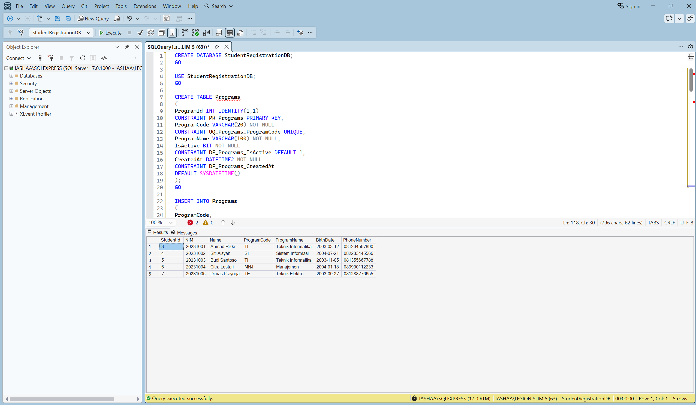
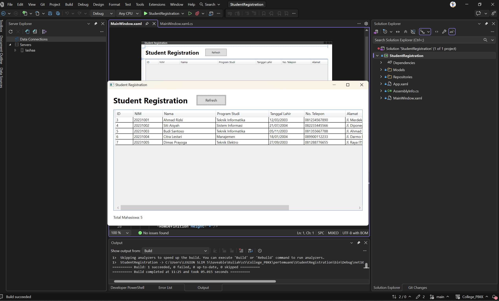

# Student Registration

Aplikasi WPF C# dengan ADO.NET dan SQL Server

## Prasyarat

- Windows dengan .NET SDK 10 dan dukungan WPF.
- SQL Server Express (`.\SQLEXPRESS`) berjalan.
- Database `StudentRegistrationDB` dari Lab 1 sudah memiliki tabel `Programs`
  dan `Students`, beserta data mahasiswa.
- Akun Windows yang menjalankan aplikasi memiliki akses ke database tersebut.

Jika instance SQL Server berbeda, sesuaikan `Server` pada `_connectionString`
di `StudentRegistration/Repositories/StudentRepository.cs`.

Hasil :


## Menjalankan

Dari folder `pertemuan6`:

```powershell
dotnet build .\StudentRegistration\StudentRegistration.csproj
dotnet run --project .\StudentRegistration\StudentRegistration.csproj
```

Project juga dapat dibuka di Visual Studio dan dijalankan dengan F5.

## Implementasi

- `Models/Student.cs`: data mahasiswa, termasuk `ProgramName` hasil JOIN.
- `Models/Program.cs`: model program studi.
- `Repositories/StudentRepository.cs`: `GetAll()` mengembalikan `List<Student>`
  melalui `SqlConnection`, `SqlCommand`, dan `SqlDataReader` dari
  `Microsoft.Data.SqlClient`. Nilai database yang nullable ditangani saat pemetaan.
- `MainWindow.xaml`: DataGrid read-only dengan kolom ID, NIM, Nama, Program Studi,
  Tanggal Lahir (`dd/MM/yyyy`), dan No. Telepon.
- `MainWindow.xaml.cs`: memuat data saat aplikasi dibuka dan tombol Refresh diklik;
  kegagalan akses database ditampilkan melalui MessageBox berjudul `Database Error`.
- Mini challenge Lab 19: kolom Alamat dan Dibuat, serta Total Mahasiswa melalui
  `GetCount()` yang menjalankan `SELECT COUNT(*) FROM Students`.

Alur: WPF → StudentRepository → ADO.NET → SQL Server → List<Student> → DataGrid.
Gunakan scrollbar horizontal DataGrid untuk melihat kolom tambahan.

Hasil Program 2 :

