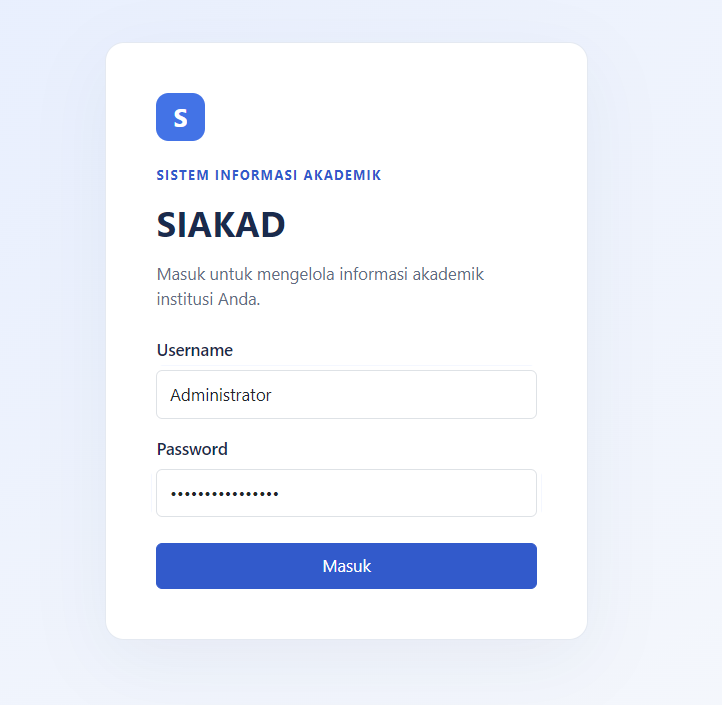
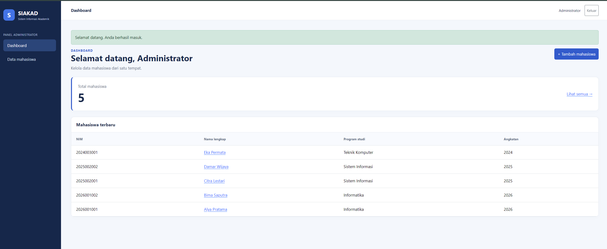
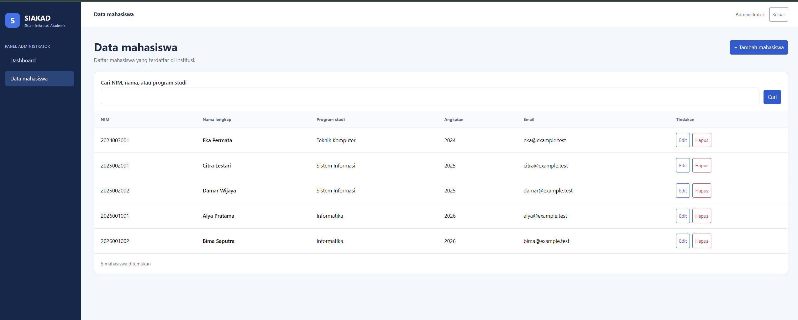
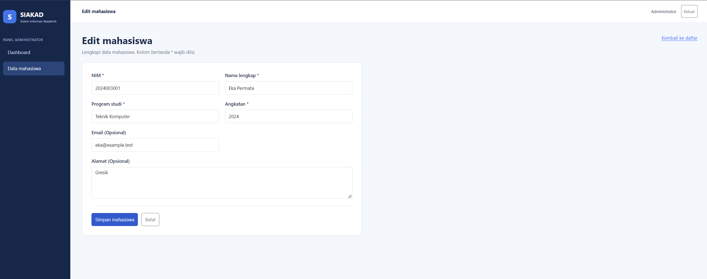
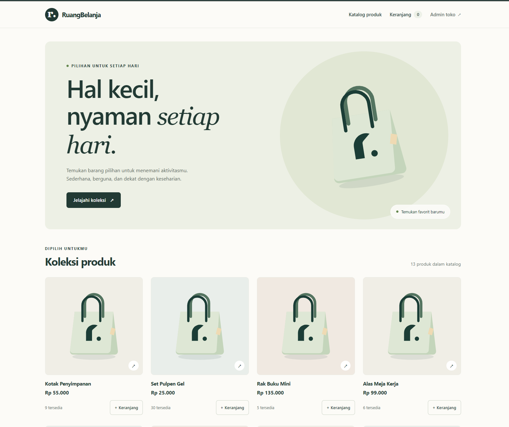
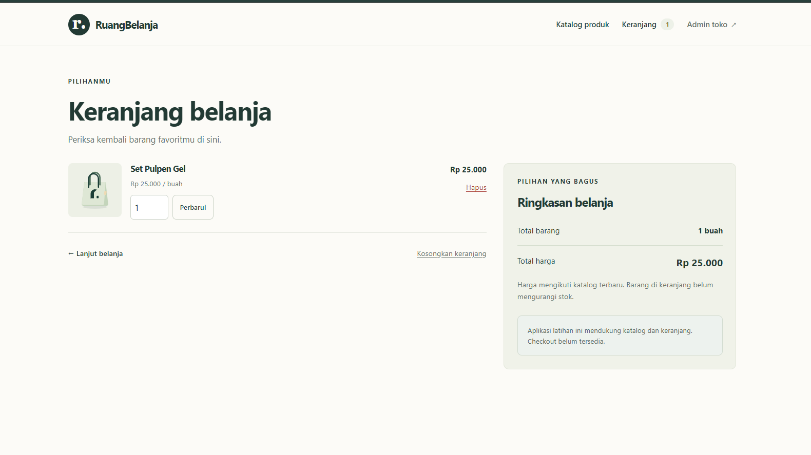
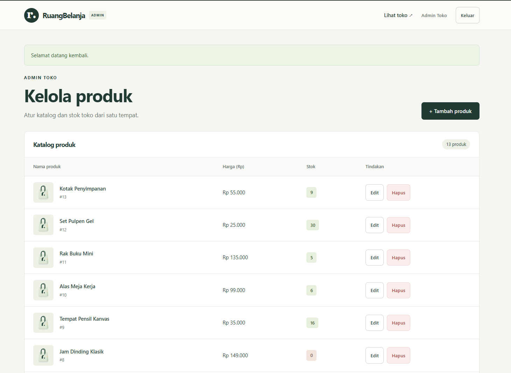
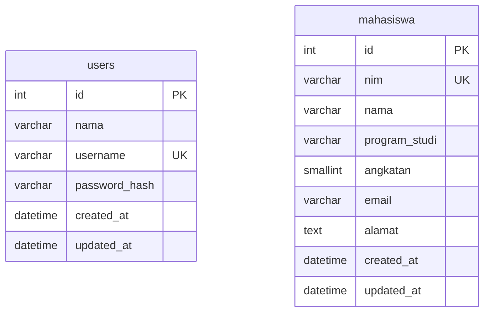
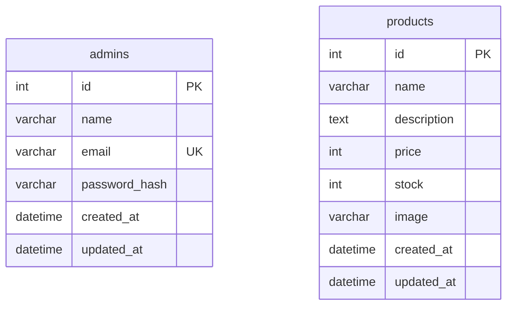

# Latihan 2 — SIAKAD dan Toko Online

Laporan ini membahas dua aplikasi berbasis **CodeIgniter 4**: **SIAKAD (Sistem Informasi Akademik)** dan **Toko Online**. Isi laporan disesuaikan dengan modul yang sudah diimplementasikan, mencakup kode penting, instalasi, model data, dan hasil pengujian.

Keduanya berada di folder fisik `latihan3/`, tetapi penomoran dalam dokumentasi menggunakan **Latihan 2a** dan **Latihan 2b**. Toko Online menampilkan merek **RuangBelanja** pada antarmukanya.

## Daftar isi

- [Sekilas teknologi dan MVC](#sekilas-teknologi-dan-mvc)
- [Latihan 2a — SIAKAD](#latihan-2a--siakad)
- [Latihan 2b — Toko Online](#latihan-2b--toko-online)
- [Instalasi dan konfigurasi](#instalasi-dan-konfigurasi)
- [Model data](#model-data)
- [Pengujian](#pengujian)
- [Referensi](#referensi)

## Sekilas teknologi dan MVC

| Komponen | Keterangan |
|---|---|
| Framework | CodeIgniter **4.7.6**, berdasarkan `composer.lock` kedua aplikasi |
| PHP | Constraint `^8.2`; pengujian laporan dijalankan pada PHP **8.2.12** |
| Dependency manager | Composer |
| Database | Migration aplikasi; MySQL/MariaDB untuk konfigurasi contoh dan SQLite untuk pengembangan/pengujian |
| Antarmuka | Bootstrap **5.3.3** melalui CDN dan CSS aplikasi di `public/assets/` |
| Pengujian | PHPUnit **10.5.66** |

Pemisahan MVC yang digunakan:

- **Model** mengakses tabel, menentukan field yang boleh disimpan, dan mendefinisikan validasi data.
- **View** menampilkan HTML, layout, partial, form, dan daftar data dengan output yang di-escape.
- **Controller** menerima input, memanggil model atau library, lalu mengembalikan view atau redirect.
- **Filter** memeriksa autentikasi sebelum mengizinkan akses halaman admin.
- **Migration dan seeder** mendefinisikan skema serta data awal agar penyiapan dapat diulang.

## Latihan 2a — SIAKAD

### Deskripsi dan modul selesai

SIAKAD merupakan aplikasi administrasi data mahasiswa dengan satu jenis pengguna, yaitu **administrator**.

| Modul | Implementasi yang tersedia | File utama |
|---|---|---|
| Autentikasi | Login/logout, verifikasi hash password, regenerasi session | `siakad/app/Controllers/Auth.php` |
| Dashboard | Jumlah mahasiswa dan lima mahasiswa terbaru | `siakad/app/Controllers/Dashboard.php` |
| Data mahasiswa | Daftar, tambah, edit, dan hapus mahasiswa | `siakad/app/Controllers/Mahasiswa.php` |
| Pencarian dan pagination | Pencarian NIM/nama/program studi; 10 data per halaman | `siakad/app/Models/MahasiswaModel.php` |
| Validasi | NIM unik, field wajib, tahun angkatan, email, dan pemulihan input | `siakad/app/Models/MahasiswaModel.php` |
| Pembatasan akses | Filter autentikasi admin dan token CSRF pada form POST | `siakad/app/Filters/AuthFilter.php`, `siakad/app/Config/Filters.php` |
| Data awal | Migration akun/mahasiswa dan seeder | `siakad/app/Database/` |


### Kode penting dan penjelasannya

#### Routing dan autentikasi

Cuplikan dari [`siakad/app/Config/Routes.php`](siakad/app/Config/Routes.php):

```php
$routes->setAutoRoute(FALSE);
$routes->get('login', 'Auth::login');
$routes->post('login', 'Auth::authenticate');
$routes->post('logout', 'Auth::logout', ['filter' => 'auth']);

$routes->group('admin', ['filter' => 'auth'], static function (RouteCollection $routes)
{
    $routes->get('/', 'Dashboard::index');
    $routes->get('mahasiswa', 'Mahasiswa::index');
    $routes->get('mahasiswa/create', 'Mahasiswa::create');
    $routes->post('mahasiswa', 'Mahasiswa::store');
    // Route edit, update, dan delete juga berada pada grup admin.
});
```

Route didefinisikan eksplisit. Pengunjung yang belum login diarahkan ke halaman login oleh filter `auth`. Perubahan data dan logout menggunakan POST.

Controller [`Auth`](siakad/app/Controllers/Auth.php) memeriksa password dengan `password_verify()`, meregenerasi session setelah login, dan hanya menyimpan identitas akun yang diperlukan. Password maupun hash tidak disimpan di session.

#### CRUD dan validasi model

Cuplikan dari [`siakad/app/Models/MahasiswaModel.php`](siakad/app/Models/MahasiswaModel.php):

```php
protected $allowedFields = ['nim', 'nama', 'program_studi', 'angkatan', 'email', 'alamat'];
protected $useTimestamps = TRUE;

protected $validationRules = [
    'id' => 'permit_empty|is_natural_no_zero',
    'nim' => 'required|max_length[30]|is_unique[mahasiswa.nim,id,{id}]',
    'nama' => 'required|max_length[100]',
    'program_studi' => 'required|max_length[100]',
    'angkatan' => 'required|integer|exact_length[4]|greater_than_equal_to[1900]|less_than_equal_to[2100]',
    'email' => 'permit_empty|valid_email|max_length[254]',
    'alamat' => 'permit_empty|max_length[2000]',
];
```

`allowedFields` membatasi kolom yang dapat diisi. Placeholder `{id}` pada aturan NIM menggunakan ID tepercaya dari route ketika data diperbarui. Jika penyimpanan gagal, controller menggunakan `withInput()` dan mengirim error model ke form.

Pencarian berada pada method `cari()`, sedangkan controller memakai `paginate(10, 'mahasiswa')`. View pagination mempertahankan parameter pencarian `q`.

#### Dashboard dan layout

[`Dashboard`](siakad/app/Controllers/Dashboard.php) mengambil jumlah mahasiswa dengan `countAllResults()` dan lima data terbaru dengan `orderBy('id', 'DESC')->findAll(5)`. View menggunakan `layouts/admin`, dengan sidebar, navbar, dan flash message sebagai partial.

### Hasil tampilan SIAKAD

Setiap blok berikut adalah tempat gambar, bukan screenshot yang sudah tersedia. Setelah gambar ditambahkan, ganti blok placeholder dengan Markdown pada komentar di bawahnya.

> **Halaman login administrator SIAKAD.**


> **Dashboard: total mahasiswa dan lima mahasiswa terbaru.**


> **Hasil pencarian mahasiswa.**


> **Form edit mahasiswa.**



## Latihan 2b — Toko Online

### Deskripsi dan modul selesai

Toko Online menyediakan katalog publik dan keranjang belanja. Pengelolaan produk dilakukan melalui panel administrator. Nama sistem dalam laporan adalah **Toko Online**, sedangkan merek antarmuka adalah **RuangBelanja**.

| Modul | Implementasi yang tersedia | File utama |
|---|---|---|
| Katalog | Daftar produk, 12 produk per halaman, dan detail produk | `tokoOnline/app/Controllers/CatalogController.php` |
| Keranjang | Tambah item, ubah jumlah, hapus item, kosongkan, subtotal/total | `tokoOnline/app/Controllers/CartController.php`, `tokoOnline/app/Libraries/Cart.php` |
| Konsistensi keranjang | Harga dibaca ulang; stok berkurang dan produk dihapus direkonsiliasi | `tokoOnline/app/Libraries/Cart.php` |
| Autentikasi admin | Login email/password, logout, filter akses | `tokoOnline/app/Controllers/Admin/AuthController.php`, `tokoOnline/app/Filters/AdminAuthFilter.php` |
| Kelola produk | CRUD dan pagination 10 data per halaman | `tokoOnline/app/Controllers/Admin/ProductController.php` |
| Upload gambar | Validasi gambar, penyimpanan nama acak, penggantian gambar | `tokoOnline/app/Controllers/Admin/ProductController.php` |
| Penyajian gambar | Endpoint gambar produk dan placeholder bawaan | `tokoOnline/app/Controllers/ProductImageController.php` |
| Data awal | Migration akun/produk dan seeder 13 produk contoh | `tokoOnline/app/Database/` |


Ruang lingkup aplikasi saat ini sampai pengelolaan produk dan keranjang. Checkout, pembayaran, pengiriman, serta riwayat pesanan tidak termasuk modul selesai.

### Kode penting dan penjelasannya

#### Katalog dan pembatasan panel admin

Cuplikan dari [`tokoOnline/app/Config/Routes.php`](tokoOnline/app/Config/Routes.php):

```php
$routes->get('/', 'CatalogController::index');
$routes->get('products/(:num)', 'CatalogController::show/$1');
$routes->get('cart', 'CartController::index');
$routes->post('cart/add', 'CartController::add');

$routes->group('admin', ['namespace' => 'App\Controllers\Admin', 'filter' => 'admin_auth'], static function ($routes)
{
    $routes->post('logout', 'AuthController::logout');
    $routes->get('products', 'ProductController::index');
    $routes->get('products/create', 'ProductController::create');
    $routes->post('products', 'ProductController::store');
    // Route edit, update, dan delete juga dilindungi filter admin_auth.
});
```

Katalog dapat diakses tanpa login. Grup admin memerlukan session administrator. Akses `/admin` diarahkan ke daftar produk, bukan dashboard statistik terpisah.

#### Session keranjang dan total belanja

[`Cart`](tokoOnline/app/Libraries/Cart.php) menyimpan pasangan ID produk dan jumlah di session. Harga selalu berasal dari database. Cuplikan proses ringkasan:

```php
$quantity = min((int) $cart[$product_id], (int) $product['stock']);

if ($quantity < 1)
{
    continue;
}

$subtotal = (int) $product['price'] * $quantity;
$items[] = ['product' => $product, 'quantity' => $quantity, 'subtotal' => $subtotal];
$normalized[$product_id] = $quantity;
$total += $subtotal;
```

Jumlah otomatis disesuaikan ketika stok turun. Produk yang sudah dihapus tidak ikut ringkasan. Saat menambah atau memperbarui jumlah, nilai melebihi stok ditolak dengan pesan kesalahan.

#### CRUD dan upload gambar

[`ProductModel`](tokoOnline/app/Models/ProductModel.php) membatasi field `name`, `description`, `price`, `stock`, dan `image`. Harga adalah rupiah bulat positif, sedangkan stok boleh nol.

Controller memvalidasi gambar dengan aturan berikut:

```php
$rules['image'] = 'uploaded[image]|is_image[image]|mime_in[image,image/jpeg,image/png,image/webp]|ext_in[image,jpg,jpeg,png,webp]|max_size[image,2048]';
```

Gambar disimpan di `writable/uploads/products/` dengan nama acak, lalu disajikan melalui endpoint `products/{id}/image`. Gambar lama dihapus setelah pembaruan berhasil. Jika produk tidak memiliki gambar, view menggunakan ilustrasi placeholder bawaan.

### Hasil tampilan Toko Online

> **Katalog produk pada halaman publik.**


> **Keranjang berisi produk dengan subtotal dan total.**


> **Halaman login administrator Toko Online.**


## Instalasi dan konfigurasi

### Persiapan

Siapkan PHP 8.2+, Composer, ekstensi `intl` dan `mbstring`, serta driver database yang digunakan. SQLite memerlukan `sqlite3`; MySQL/MariaDB memerlukan `mysqli`/`mysqlnd`. Styling Bootstrap dari CDN memerlukan koneksi internet.

Jalankan langkah di bawah dari folder aplikasi yang bersangkutan:

| Aplikasi | Folder kerja | Port pada contoh | Database MySQL contoh |
|---|---|---|---|
| SIAKAD | `latihan3/siakad/` | 8082 | `siakad` |
| Toko Online | `latihan3/tokoOnline/` | 8083 | `toko_online` |

```console
composer install
```

Salin `.env.example` menjadi `.env` jika belum ada, lalu sesuaikan URL dan koneksi database. Buat database MySQL yang dipilih sebelum menjalankan migration. Kredensial admin untuk seeder dibaca dari environment:

| Aplikasi | Konfigurasi akun awal |
|---|---|
| SIAKAD | `admin.username`, `admin.nama`, `admin.password` |
| Toko Online | `shop.adminName`, `shop.adminEmail`, `shop.adminPassword` |

Password admin diisi sendiri dengan minimal 12 karakter. Seeder tidak menimpa akun yang sudah ada; mengganti password di `.env` tidak otomatis mengubah password akun tersimpan.

### Migration, seeder, dan server

Pada setiap aplikasi:

```console
php spark migrate
php spark db:seed DatabaseSeeder
```

Kemudian jalankan di terminal terpisah:

```console
# Dari latihan3/siakad/
php spark serve --port 8082
```

```console
# Dari latihan3/tokoOnline/
php spark serve --port 8083
```

Buka **http://localhost:8082/login** untuk SIAKAD dan **http://localhost:8083/** untuk Toko Online. Panduan database serta alternatif PHP XAMPP terdapat pada [README SIAKAD](siakad/README.md) dan [README Toko Online](tokoOnline/README.md).

## Model data

### SIAKAD

Skema mengikuti migration di [`siakad/app/Database/Migrations/`](siakad/app/Database/Migrations/). Akun administrator dan data mahasiswa berada pada tabel terpisah **tanpa foreign key di antara keduanya**. Data mahasiswa bukan akun login pada versi ini.

| Tabel | Kolom utama | Aturan |
|---|---|---|
| `users` | `id`, `nama`, `username`, `password_hash`, timestamps | `id` primary key; `username` unik |
| `mahasiswa` | `id`, `nim`, `nama`, `program_studi`, `angkatan`, `email`, `alamat`, timestamps | `id` primary key; `nim` unik; email/alamat nullable |



`program_studi` disimpan sebagai teks pada tabel mahasiswa. Tidak ada tabel prodi, dosen, KRS, atau nilai pada migration saat ini.

### Toko Online

Skema mengikuti migration di [`tokoOnline/app/Database/Migrations/`](tokoOnline/app/Database/Migrations/). Tabel `admins` dan `products` tidak memiliki foreign key di antara keduanya. Keranjang disimpan di session, bukan tabel transaksi.

| Tabel | Kolom utama | Aturan |
|---|---|---|
| `admins` | `id`, `name`, `email`, `password_hash`, timestamps | `id` primary key; email unik |
| `products` | `id`, `name`, `description`, `price`, `stock`, `image`, timestamps | `id` primary key; harga/stok integer; description/image nullable |



`price` menggunakan rupiah bulat. `image` menyimpan nama file, sedangkan berkasnya berada di `writable/uploads/products/`.

## Pengujian

Pengujian dijalankan pada **3 November 2026** dari masing-masing folder aplikasi:

```console
php -d extension=intl -d extension=sqlite3 vendor/phpunit/phpunit/phpunit --no-coverage
```

| Aplikasi | Hasil eksekusi |
|---|---|
| SIAKAD | **OK — 21 tests, 92 assertions** |
| Toko Online | **OK — 19 tests, 75 assertions** |

Test suite SIAKAD mencakup autentikasi, pembatasan akses, CSRF, CRUD, validasi, pencarian, pagination, escaping, dan seeder. Test suite Toko Online mencakup katalog, pagination, autentikasi admin, CRUD, validasi produk, dan alur keranjang. Upload gambar sudah diimplementasikan pada controller, tetapi pengujian unggah melalui browser tidak dilakukan pada sesi dokumentasi ini. Database pengujian terpisah dari data aplikasi.

Hasil ini adalah pengujian otomatis. Placeholder gambar sengaja disediakan untuk diisi sendiri; laporan belum menyatakan pemeriksaan visual atau screenshot seluruh halaman selesai.

## Referensi

- [Konsep MVC CodeIgniter 4](https://codeigniter.com/user_guide/concepts/mvc.html)
- [Routing](https://codeigniter.com/user_guide/incoming/routing.html)
- [Models](https://codeigniter.com/user_guide/models/model.html)
- [Controller Filters](https://codeigniter.com/user_guide/incoming/filters.html)
- [Database Migrations](https://codeigniter.com/user_guide/dbmgmt/migration.html)
- [Session](https://codeigniter.com/user_guide/libraries/sessions.html)
- [File Uploads](https://codeigniter.com/user_guide/libraries/uploaded_files.html)
- [Testing](https://codeigniter.com/user_guide/testing/overview.html)
- [Bootstrap](https://getbootstrap.com/docs/5.3/getting-started/introduction/)
- [Overview tutorial SIAKAD](overview_sistem_informasi_akademik_codeigniter.md)
- [Overview tutorial Toko Online](overview_toko_online_codeigniter.md)

[Panduan menambahkan screenshot](../docs/screenshots/README.md) · [Kembali ke daftar latihan](../README.md)
